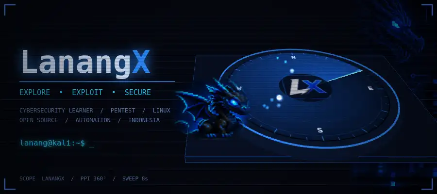
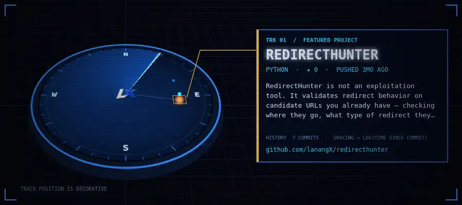
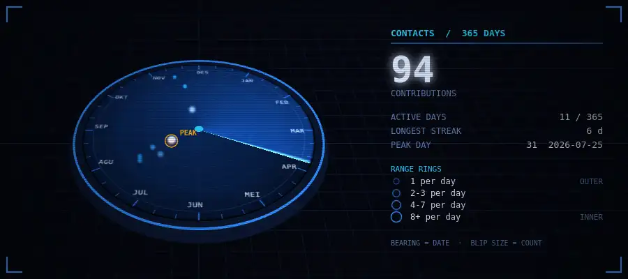
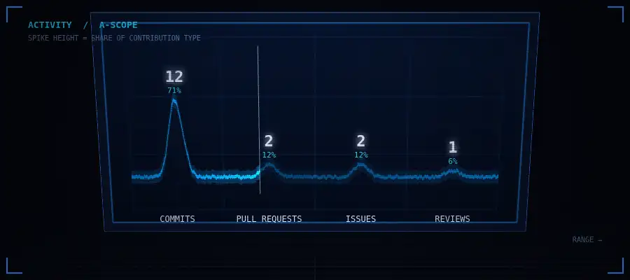
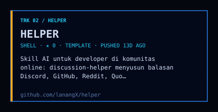
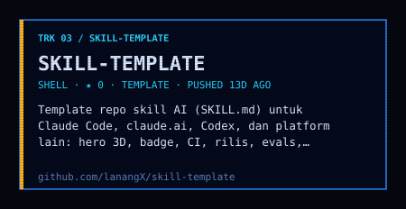

<picture><source media="(prefers-reduced-motion: reduce)" srcset="https://raw.githubusercontent.com/lanangX/lanangx/assets/header-static.png"></picture>

<a href="https://github.com/lanangX/redirecthunter"><picture><source media="(prefers-reduced-motion: reduce)" srcset="https://raw.githubusercontent.com/lanangX/lanangx/assets/feature-static.png"></picture></a>
<picture><source media="(prefers-reduced-motion: reduce)" srcset="https://raw.githubusercontent.com/lanangX/lanangx/assets/contribution-static.png"></picture>
<picture><source media="(prefers-reduced-motion: reduce)" srcset="https://raw.githubusercontent.com/lanangX/lanangx/assets/activity-static.png"></picture>

